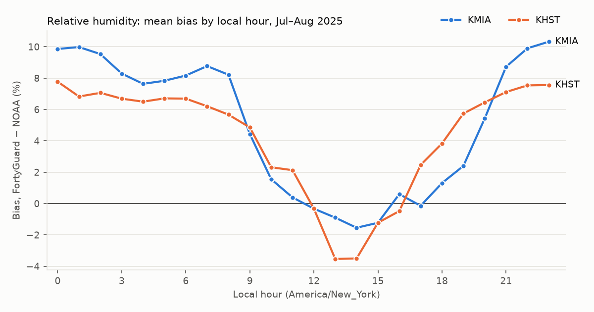
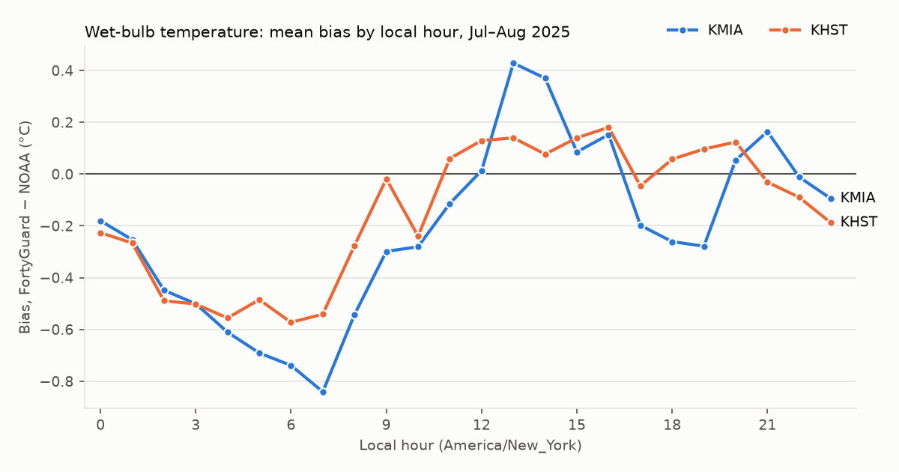
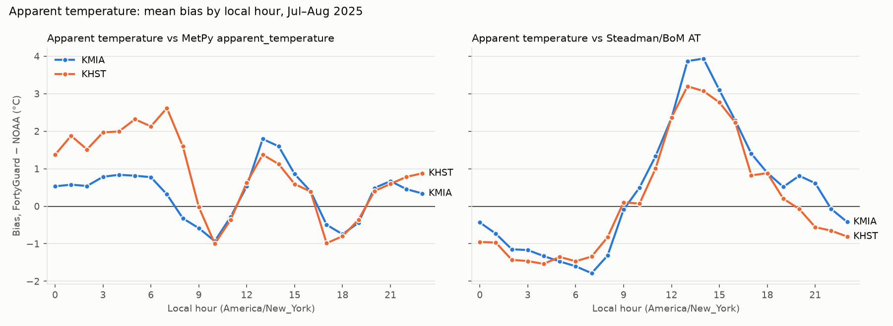

# Miami-Dade Heat Brief

An n8n agent that uses the FortyGuard Temperature MCP to produce a daily heat-risk brief for Miami-Dade.
Fixed rules decide the risk level, the LLM explains it, and code checks every number before a brief is sent.
The data is checked against NOAA weather stations, and the agent is replayed on summer 2025 against the heat advisories the National Weather Service actually issued.

> Status: Data evaluation complete (July–August 2025, KMIA and KHST). n8n heat-brief agent: in progress.

## Why Miami-Dade
Miami-Dade has long, humid heat seasons, and humidity is what makes heat dangerous for outdoor workers.
TODO: name the one decision the brief supports (e.g. work/rest scheduling for outdoor crews) and cite the official thresholds used.

## What I found about the data
Before building anything, I checked what FortyGuard's `env_params` tool returns.

- One call returns one point for one day, as 24 hourly values (local time, America/New_York). It costs 2,900 credits.
- **`heat_index_celsius` depends on the reference temperature the user sends.** Recomputing it with the NWS heat index formula from the constant reference temperature (33 °C) and the hourly humidity reproduces all 24 values within 0.1 °C. It therefore peaks at 07:00, when humidity is highest, instead of in the afternoon.
- **Controlled test:** same point and day, reference temperature 33 °C vs 28 °C. Only `heat_index_celsius` changed; every other hourly field was identical.
- The response contains no measured air temperature.

**Decision:** the risk rules use wet-bulb temperature and apparent temperature. Heat index is computed from FortyGuard-implied air temperature (solved from FortyGuard wet-bulb + RH) and checked against NOAA.

Full notes: [notes/mcp-field-notes.md](notes/mcp-field-notes.md)

## Ground truth
| Station | Name | Lat, Lon | Missing hours, Jun–Sep 2025 |
|---|---|---|---|
| KMIA | Miami International Airport | 25.788, -80.3169 | 0.34% |
| KHST | Homestead AFB | 25.4884, -80.3837 | 6.80% |

Source: Iowa Environmental Mesonet ASOS network metadata (FL_ASOS).
FortyGuard is queried at these exact coordinates so both sources describe the same place.
Limitation: airports are open and windy, so they do not show the hottest streets; some difference from a hyperlocal model is expected.

## Results
July–August 2025, 124 station-days. Full numbers and method: [notes/results-summary.md](notes/results-summary.md) ([PDF](notes/results-summary.pdf)).

### Accuracy: FortyGuard vs NOAA
Each FortyGuard local hour is matched to the nearest routine METAR within ±30 min. Hours on NOAA QA-flagged station-days are excluded.
Baseline: leave-one-day-out NOAA climatology for the same station and local hour. Skill = 1 − MAE_FG / MAE_baseline; positive means FortyGuard beats the baseline.

| Station | Variable | n | Bias | MAE | RMSE | r | Baseline MAE | Baseline RMSE | Skill |
|---|---|---|---|---|---|---|---|---|---|
| KMIA | RH (%) | 1,464 | +4.97 | 7.82 | 9.61 | 0.792 | 5.91 | 7.70 | −0.32 |
| KMIA | Wet-bulb (°C) | 1,464 | −0.21 | 0.72 | 0.93 | 0.529 | 0.71 | 0.90 | −0.02 |
| KMIA | AT vs MetPy (°C) | 1,460 | +0.36 | 2.07 | 2.88 | 0.734 | 2.69 | 3.48 | +0.23 |
| KMIA | AT vs Steadman (°C) | 1,460 | +0.42 | 1.90 | 2.46 | 0.618 | 1.56 | 2.05 | −0.22 |
| KHST | RH (%) | 1,191 | +4.20 | 6.96 | 8.63 | 0.833 | 5.13 | 6.68 | −0.36 |
| KHST | Wet-bulb (°C) | 1,191 | −0.15 | 0.71 | 0.96 | 0.514 | 0.69 | 0.91 | −0.03 |
| KHST | AT vs MetPy (°C) | 1,191 | +0.86 | 2.43 | 3.20 | 0.751 | 2.71 | 3.43 | +0.10 |
| KHST | AT vs Steadman (°C) | 1,191 | +0.14 | 1.82 | 2.42 | 0.627 | 1.56 | 2.09 | −0.17 |
| Both | RH (%) | 2,655 | +4.62 | 7.43 | 9.18 | 0.810 | 5.56 | 7.26 | −0.34 |
| Both | Wet-bulb (°C) | 2,655 | −0.18 | 0.72 | 0.95 | 0.524 | 0.70 | 0.91 | −0.02 |
| Both | AT vs MetPy (°C) | 2,651 | +0.58 | 2.23 | 3.03 | 0.742 | 2.70 | 3.46 | +0.17 |
| Both | AT vs Steadman (°C) | 2,651 | +0.30 | 1.86 | 2.44 | 0.622 | 1.56 | 2.07 | −0.20 |

FortyGuard doesn't document its apparent-temperature formula, so it is compared with two definitions. Steadman/BoM fits better by MAE and RMSE; MetPy fits better by correlation.

Bias by local hour:





RH runs about +7 to +10 % too high overnight and slightly low at 13–14 h. Wet-bulb bias ranges from −0.84 °C (KMIA, 07 h) to +0.43 °C (KMIA, 13 h).

### FortyGuard-implied air temperature
FortyGuard returns no air temperature. For each hour, air temperature is solved so that MetPy's wet-bulb from that temperature and FortyGuard RH equals FortyGuard wet-bulb (`scripts/implied_temperature.py`). The solve converged for 2,976 / 2,976 hours.

| Implied T − NOAA T | n | Bias (°C) | MAE | RMSE | r |
|---|---|---|---|---|---|
| KMIA | 1,464 | −0.94 | 1.56 | 1.94 | 0.823 |
| KHST | 1,191 | −0.74 | 1.39 | 1.81 | 0.837 |
| Both | 2,655 | −0.85 | 1.48 | 1.89 | 0.829 |

Implied T is about 1.5–1.8 °C too cool overnight (00–08 h) and about 0.8 °C too warm at 13–14 h. It is sensitive to RH: ±5 percentage points of RH moves it by about ∓0.8 °C.

### Advisory replay vs NWS Heat Advisories
Rule: heat index at or above the threshold for at least 2 hours of a local day. Truth: the 11 days per station on which NWS Miami issued a Heat Advisory (HT.Y) for the station's zone. Days: station-days not QA-flagged (KMIA 61 days, 11 advisory; KHST 50 days, 9 advisory).

Hits / misses / false alarms / correct negatives, then CSI:

| Rule | Station | 103 °F | 105 °F (NWS MFL criterion) | 108 °F |
|---|---|---|---|---|
| NOAA observed HI | KMIA | 6/5/9/41, 0.30 | 0/11/0/50, 0.00 | 0/11/0/50, 0.00 |
| NOAA observed HI | KHST | 2/7/4/37, 0.15 | 0/9/0/41, 0.00 | 0/9/0/41, 0.00 |
| FG implied HI | KMIA | 8/3/10/40, 0.38 | 2/9/2/48, 0.15 | 0/11/1/49, 0.00 |
| FG implied HI | KHST | 4/5/2/39, 0.36 | 0/9/0/41, 0.00 | 0/9/0/41, 0.00 |
| FG apparent temp | KMIA | 7/4/10/40, 0.33 | 2/9/2/48, 0.15 | 0/11/0/50, 0.00 |
| FG apparent temp | KHST | 3/6/3/38, 0.25 | 0/9/1/40, 0.00 | 0/9/0/41, 0.00 |

The airport NOAA observations themselves never meet the 105 °F / 2 h rule on any day. Heat index reached 105 °F in only 6 hours at KMIA and 5 at KHST, never twice on one day. This is expected, because NWS advisories are **zone-wide forecasts**. They are issued ahead of time for a whole forecast zone, not from one station's observed values. One airport's observations for the same day measure something different, so low hit rates at 105 °F say more about the comparison than about either data source. At 103 °F the FortyGuard rules have a higher CSI than the NOAA observations at both stations, but also more false alarms at KMIA.

Validator results (briefs checked, numbers caught): TODO, with the n8n agent.

## Data not included
Raw FortyGuard responses (`data/raw_api/`, `data/raw/`) and the hourly and daily files derived from them (`results/matched_hourly.csv`, `results/implied_temperature_hourly.csv`, `results/replay_daily.csv`) are not published. To regenerate them, put a FortyGuard API key in `.env` and fetch the data with `scripts/fetch_env_rest.py`. Then run `scripts/eval_accuracy.py`, `scripts/implied_temperature.py` and `scripts/replay_advisories.py`. The NOAA and NWS inputs, aggregate metrics and charts are included.

## Limitations
- NWS advisories are issued from forecasts. The replay uses observations (NOAA) and FortyGuard values for the same day.
- Advisories are per zone. Each station is one point in its zone.
- Two of KHST's 11 advisory days (08-06, 08-27) fall on QA-flagged days and are excluded from the primary replay set.
- The baseline is in-sample climatology from the same two months, not an independent forecast.
- FortyGuard provides no air temperature. Implied T inherits errors in FortyGuard RH and wet-bulb (see the RH sensitivity above).
- MetPy `heat_index` differs from the NWS formula by up to 2.2 °F, but only at 77–79 °F air temperature (HI ≈ 79–81 °F), well away from 103–108 °F.
- One IEM observation (KMIA 2025-07-07 10:53 UTC) has `relh` 96.7 %, inconsistent with its own T/Td (80/77 °F). RH computed from T/Td is used.
- The NWS API shows both zones with `effectiveDate` 2026-04-16. The 2025 events were found under the same zone codes.
- The 2025 Heat Advisory criterion (105 °F for 2 h) comes from the 2024 NWS MFL pilot page and 2025 news coverage. The 2025 rule text was not found on an NWS page ([notes/thresholds.md](notes/thresholds.md)).
- Airports are open and windy, so they do not show the hottest streets.

## How it works
TODO: diagram and n8n workflow screenshot (schedule → AI Agent + FortyGuard MCP → rules → LLM brief → validator → Telegram)

## Run it yourself
```bash
git clone https://github.com/Abrik-Ai/miami-dade-heat-brief
cd miami-dade-heat-brief
uv sync
cp .env.example .env   # add your FORTYGUARD_API_KEY
```
TODO: n8n setup, tests, replay

## Repository layout
- `data/locations.csv` — station coordinates with sources
- `data/raw/`, `data/raw_api/` — raw FortyGuard responses (not committed, see [Data not included](#data-not-included))
- `results/` — aggregate metrics and charts
- `scripts/` — data fetching, accuracy, implied temperature and advisory replay
- `notes/results-summary.md` — all results and method choices for steps 1–7
- `data/noaa/`, `data/nws/` — station observations and advisory archive
- `notes/mcp-field-notes.md` — findings from using the MCP as a new user
- `PLAN.md` — goal, current step, log

## Acknowledgements
Data from the FortyGuard Temperature API and MCP, NOAA ASOS stations via the Iowa Environmental Mesonet, and the National Weather Service.
